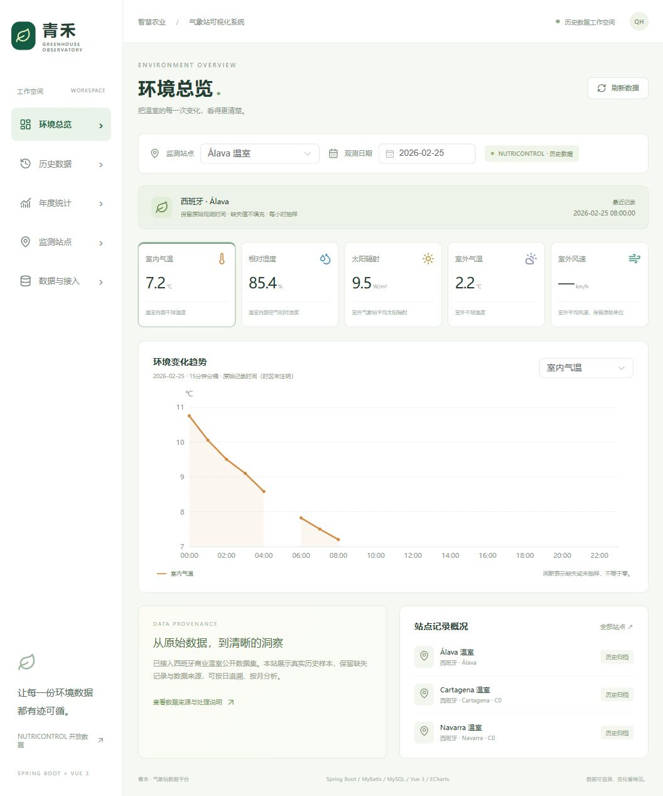
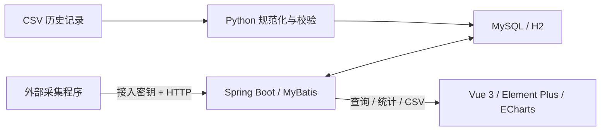

# 东北旺试验田气象站可视化系统（演示）

**Spring Boot + MyBatis + MySQL + Vue 3 + ECharts**。围绕气象观测数据的集中存储、历史追溯与趋势分析，提供完整的前后端工程、配套样本数据、测试与部署配置。

系统以东北旺试验田气象数据管理为演示场景，支持多站点查询、环境趋势展示、年度统计和采集端接入。



## 功能

- **环境总览**：支持三个示例站点切换，展示气温、湿度、太阳辐射、室外温度和风速，按日查看环境变化趋势。
- **历史查询**：按站点、日期分页检索；CSV 导出；保留数据来源与缺失值。
- **年度统计**：按指标生成12个月的均值、极值和有效观测数；无记录月份留空。
- **数据接入**：带密钥的批量 HTTP API，参数校验、唯一键、幂等重试与冲突批次回滚。
- **数据管理**：保留观测时间、数据标识与处理记录，通过校验清单核对样本完整性。

本工程实现数据库设计、后端业务接口和前端可视化，采集端通过 HTTP 接口接入，支持后续导入实际设备上报的观测记录。

## 快速运行：无需先安装 MySQL

环境：Java 17+、Node.js 22.12+、npm。Maven Wrapper 已包含在仓库，首次构建需联网下载依赖。

终端一：

```sh
cd backend
./mvnw spring-boot:run
# Windows PowerShell 使用 .\mvnw.cmd spring-boot:run
```

终端二：

```sh
cd frontend
npm ci
npm run dev
```

打开 **http://localhost:5173**。默认 `dataset` profile 使用内存 H2（MySQL 模式），自动加载随仓库提供的77,169条小时样本；重启后重新加载，适合快速体验。前端将 `/api` 代理到8080端口。

## Docker Compose：MySQL 持久化部署

需要 Docker Engine / Docker Desktop 及 Compose v2。

```sh
python scripts/init_env.py
docker compose up -d --build
```

打开 **http://localhost:8088**。`init_env.py` 生成随机数据库密码及数据接入密钥，不覆盖已有 `.env`；该文件已排除在 Git 之外。

Compose 启动 MySQL 8.4、Spring Boot API 和 Nginx。数据库数据保存在命名卷 `mysql_data` 中，重启不丢失；首次启动会导入配套历史样本。默认仅将网页端口绑定到本机回环地址。部署到阿里云等服务器时，建议使用域名、HTTPS 反向代理及受控入口，配置见 [部署说明](docs/DEPLOYMENT.md)。

## 数据与接入

项目提供77,169条历史样本，便于直接体验站点切换、分页查询、趋势图和年度统计。接入自己的观测数据时，可使用批量 HTTP API 或 CSV 导入工具。

**太阳辐射单位为 W/m²，风速单位为 km/h**。系统保留原始观测时间与缺失值，各项统计基于已导入的有效记录计算。

样本出处、许可、字段映射、处理规则及全量数据导入方法统一见 [数据说明](docs/DATA_SOURCES.md)。

## 架构与目录



```text
backend/         Java 17 / Spring Boot 3.5 / MyBatis / Flyway / 接口测试
frontend/        Vue 3 / TypeScript / Element Plus / ECharts / Vite
scripts/         数据下载、规范化、批量导入与运行验收（Python 标准库）
docs/            API、数据来源、部署、验证说明与实际页面截图
compose.yml      MySQL + API + Nginx
.github/         GitHub Actions：H2、MySQL、前端和数据校验
```

关键设计：

- 观测表使用 `(station_code, observed_at)` 唯一索引；日期查询采用半开区间，便于走联合索引。
- 统计指标来自固定枚举与 SQL 分支，禁止客户端注入列名。
- 数值缺失保留为 null；聚合分别统计每个指标有效值，前端区分零与缺失。
- 批次入库使用事务；相同观测可重试，冲突回滚；并发重复请求由唯一键和锁定读保证一致。
- 前端取消过期查询并处理异常与空数据；图表通过 ResizeObserver 适配容器并在卸载时释放实例。

## 开发与验证

```sh
cd backend
./mvnw verify

cd ../frontend
npm test
npm run build

cd ..
python -m unittest discover -s scripts -p 'test_*.py' -v
python scripts/verify_live.py
```

`verify_live.py` 在应用运行时将 API 的三个站点查询、月度均值、极值及有效点数与随仓库提供的原始规范化样本逐项比较。MySQL 集成测试可设置 `TEST_DATABASE_URL`、`TEST_DATABASE_USER`、`TEST_DATABASE_PASSWORD` 后运行后端测试，必须指向单独的测试库；测试会清空该库的 observation 表。

具体验证结果见 [验证记录](docs/VERIFICATION.md)。接口参数、响应与接入样例见 [API 文档](docs/API.md)。

## 许可

自编软件采用 [MIT](LICENSE)；数据样本采用 **CC BY 4.0**，出处和署名见上述数据说明。Maven Wrapper 脚本保留其 Apache-2.0 文件头与原始许可声明。
