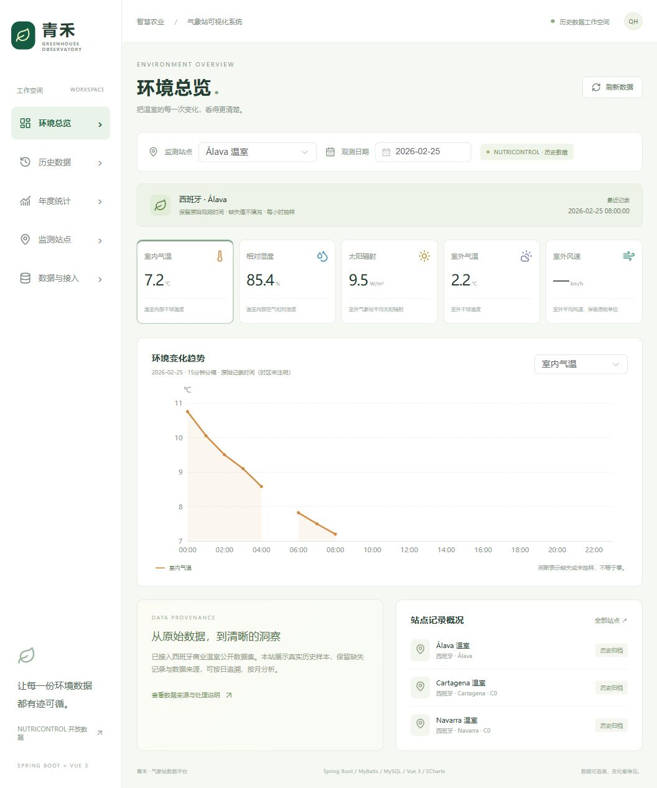
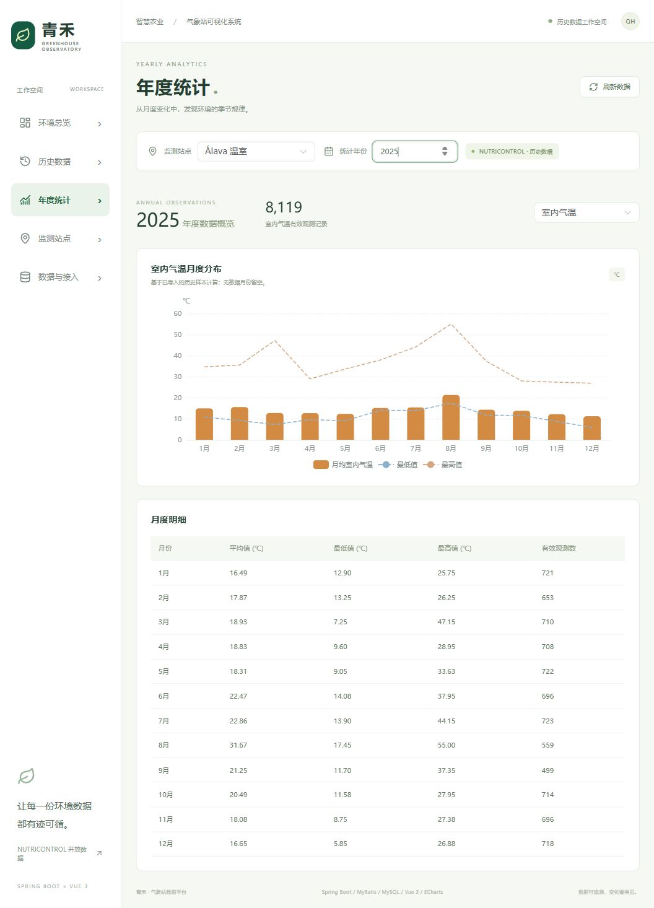

# 验证记录

验证环境：Windows，Java 17、Node.js 24、MySQL 8.0.44；前端通过真实浏览器连接本地 API。以下记录对应本次实现，不是历史项目运行指标。

| 验证项 | 结果 |
|---|---|
| 后端 H2 集成测试 | 27项通过 |
| 后端真实 MySQL 集成测试 | 同一组27项通过 |
| 前端类型检查与生产构建 | 通过 |
| API 与数据格式前端测试 | 7项通过 |
| 年份筛选交互回归测试 | 1项通过，前端合计8项 |
| Python 数据校验 | 3项通过 |
| 真实 MySQL/API 与源样本比对 | 447项断言通过，覆盖三个站点的日期查询、月度均值、极值和有效观测数 |
| Docker Compose 配置 | `docker compose config --quiet` 通过 |

后端测试覆盖站点隔离、半开日期边界、分页范围、15分钟分桶、空值聚合、年度隔离、非法指标、CSV空值与零、接入鉴权、数值校验、未来时间拒绝、重复提交、并发幂等以及整批回滚。

页面实测：

- 环境总览默认打开 Álava 最近有记录的2026-02-25，缺失风速显示为 `—`；图表不跨越缺失时段连线。
- 历史页面筛选2025-06-01，显示24条记录；第二页4条，时间00:00—03:00。
- 浏览器点击导出成功下载24行数据的 CSV，保留 nutricontrol 来源。
- 年度统计切换2025，输入、标题与12个月的数据图表保持一致。
- 站点页面列出 Álava、Navarra C0、Cartagena C0；数据来源页面包含作者、CC BY 4.0、DOI、单位与缺失处理说明。

本地 Docker Engine 未启动，因此本次未执行完整的 Compose 容器构建和启动验收；已在独立真实 MySQL 实例上验证数据库迁移、数据装载和接口。云服务器部署未执行。
